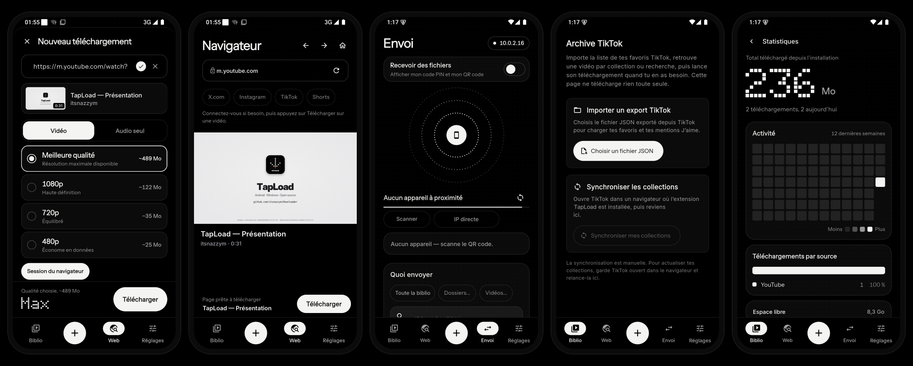
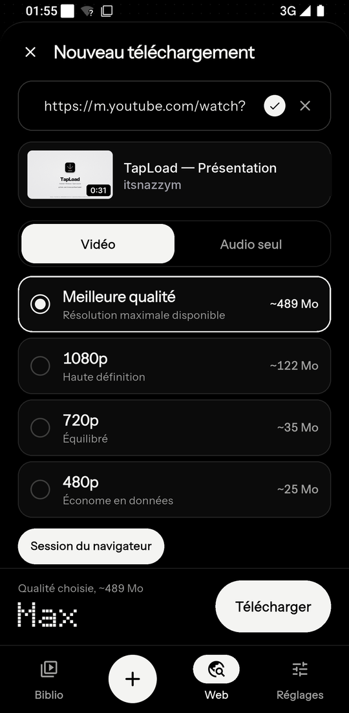
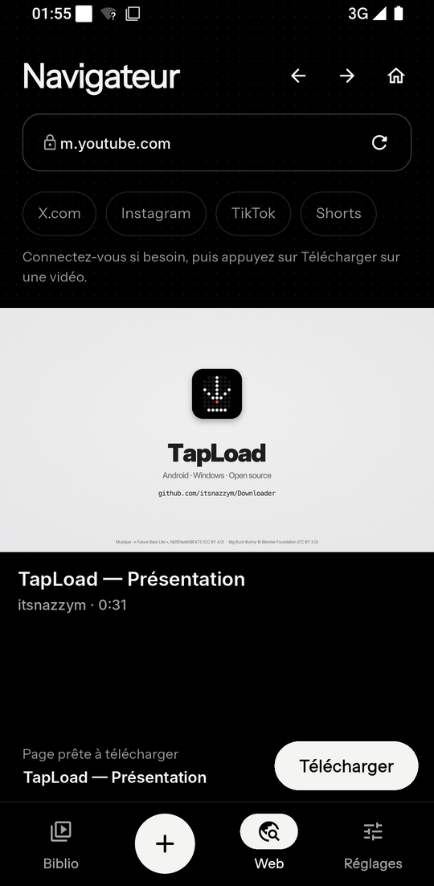
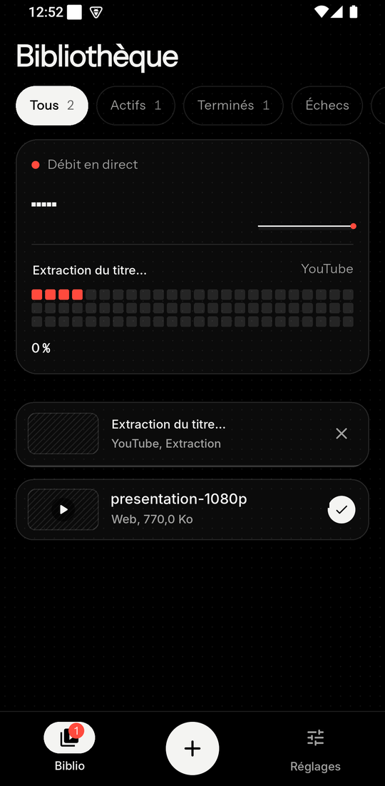
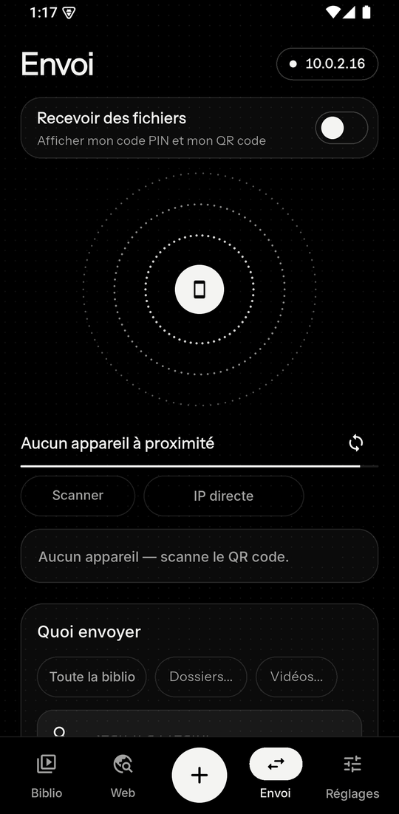
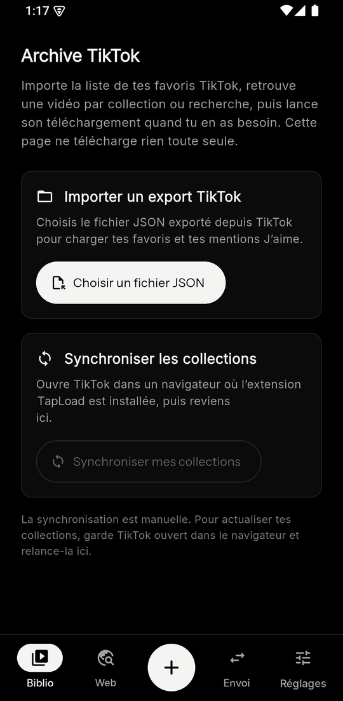
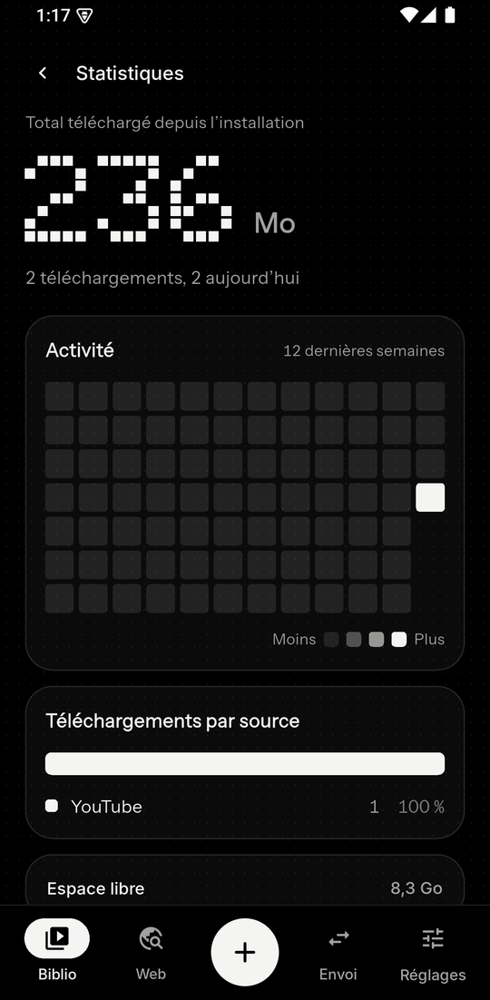
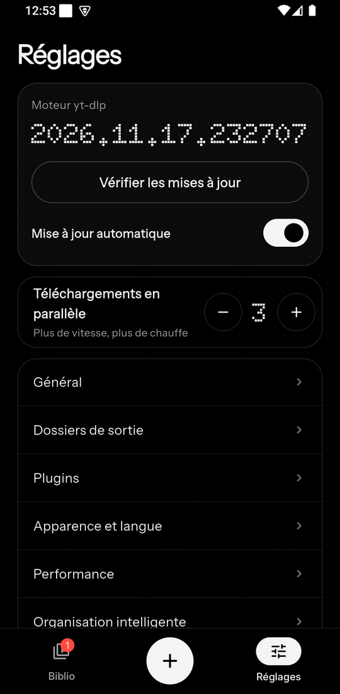

<div align="center">


# TapLoad

Téléchargeur multimédia pour Android et Windows. Open source, sans publicité.

[](https://github.com/itsnazzym/Downloader/releases)
[](https://github.com/itsnazzym/Downloader/actions)
[](LICENSE)

<br />

[](marketing/launch-film/tapload-launch-1080p60.mp4)

<sub>Film de lancement, 30 s, 16:9 : [tapload-launch-1080p60.mp4](marketing/launch-film/tapload-launch-1080p60.mp4) · musique « Future Bass Lite », NERDtasticBEATS (CC BY 4.0)</sub>

</div>

## Présentation

TapLoad enregistre des vidéos et des pistes audio depuis la page d'un navigateur ou le menu Partager d'Android. Le téléchargement s'appuie sur `yt-dlp`, `gallery-dl`, `aria2c` et `ffmpeg`. L'application existe en français, en anglais et en arabe.



## Fonctionnalités

- **Téléchargement** : choix de la qualité ou de l'audio seul, file d'attente, accélération `aria2c`, remuxage `ffmpeg`.
- **Android** : partage depuis une autre application, navigateur intégré avec barre de capture, fichiers enregistrés dans `Download/TapLoad/`.
- **Extension navigateur** (Chrome, Brave, Edge, Firefox ; Manifest V3) : envoie l'onglet courant à l'application. La liaison passe par WebSocket sur `127.0.0.1:6969`, authentifiée par jeton.
- **Envoi local** : transfert entre PC et téléphone sur le réseau local, par QR code ou adresse IP.
- **Archive TikTok** : import de l'export JSON de TikTok, collections synchronisées depuis le navigateur, lecteur vertical intégré.
- **Tor** (Windows, optionnel) : le service démarre avec le réglage proxy ; les téléchargements échouent plutôt que de contourner le proxy s'il est indisponible.
- **Plugins** : modules activables dans les réglages, par exemple Smart Organizer.

## Installation

Les binaires sont publiés dans les [Releases](https://github.com/itsnazzym/Downloader/releases) :

| Cible | Fichier |
|---|---|
| Windows 10 / 11 | Installeur `.exe` ou archive portable `.zip` |
| Android (arm64) | `.apk` |
| Chrome, Brave, Edge | Dossier `extension/chrome/` à charger en mode développeur |
| Firefox | `.xpi` signé |

Les empreintes SHA-256 des builds sont dans [`release/SHA256SUMS.txt`](release/SHA256SUMS.txt). Sous Windows, `yt-dlp`, `ffmpeg`, `ffprobe`, `aria2c`, `gobird` et le bundle Tor sont vérifiés au premier lancement.

## Captures

| Téléchargement | Navigateur | Bibliothèque | Envoi |
|---|---|---|---|
|  |  |  |  |

| Archive TikTok | Statistiques | Réglages |
|---|---|---|
|  |  |  |

<sub>La vidéo de démonstration visible dans les captures est le film de présentation de TapLoad.</sub>

## Développement

Prérequis : [Flutter](https://flutter.dev) stable (SDK Dart `^3.10`, voir `pubspec.yaml`). Pour Android, utiliser Flutter 3.44.x (Gradle 8.13, AGP 8.11) ; les versions 3.50 et suivantes exigent Gradle 9 et ne compilent pas encore le projet. Pour Windows, Visual Studio 2022 avec la charge de travail *Desktop development with C++*.

```bash
git clone https://github.com/itsnazzym/Downloader.git
cd Downloader
flutter pub get
dart run tool/build_extension.dart   # extensions Chrome et Firefox
flutter run -d windows
```

```bash
flutter analyze
flutter test
```

Packaging :

```powershell
powershell -ExecutionPolicy Bypass -File tool/package_windows.ps1              # installeur + portable
powershell -ExecutionPolicy Bypass -File tool/package_windows.ps1 -PortableOnly
flutter build apk --target-platform android-arm64 --release
```

Pour contribuer, voir [`CONTRIBUTING.md`](CONTRIBUTING.md).

## Architecture

L'extension envoie l'URL de l'onglet au serveur local de l'application, qui met le téléchargement en file puis délègue à `yt-dlp` ou `gallery-dl`, `aria2c` et `ffmpeg`. Le détail est dans [`docs/ARCHITECTURE.md`](docs/ARCHITECTURE.md).

## Confidentialité

Le serveur local n'écoute que sur `127.0.0.1`. Le détail pour l'extension est dans [`extension/privacy.md`](extension/privacy.md).

## Licence

[MIT](LICENSE)
