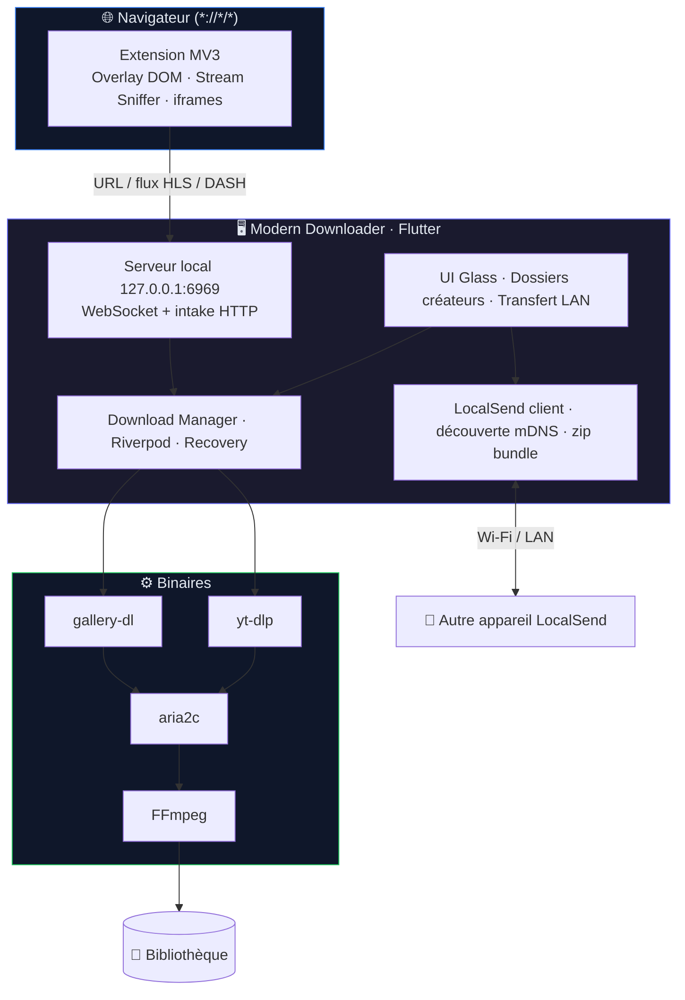

<div align="center">


# Modern Downloader

**Téléchargeur de médias moderne, fluide et privé pour Windows et Android**  
*Modern, high-performance, privacy-first media downloader, library manager & LAN transfer*

<br />

[](https://github.com/itsnazzym/Downloader/actions/workflows/ci.yml)
[](https://github.com/itsnazzym/Downloader/releases)
[](LICENSE)
[](https://github.com/itsnazzym/Downloader/releases)
[](https://flutter.dev)

**App `v1.0.8`** · **Extension `v2.1.14`**

[Téléchargements / Releases](https://github.com/itsnazzym/Downloader/releases) · [Extensions](#-extensions-navigateur-universelles--browser-extensions) · [Transfert LAN](#-transfert-réseau-local-lan-sync) · [Démarrage rapide](#-démarrage-rapide--quick-start) · [Confidentialité](extension/privacy.md)

</div>

---

## Sommaire / Table of Contents

- [Fonctionnalités clés](#-fonctionnalités-clés--key-features)
- [Architecture](#-architecture)
- [Démarrage rapide](#-démarrage-rapide--quick-start)
- [Extensions navigateur](#-extensions-navigateur-universelles--browser-extensions)
- [Transfert réseau local](#-transfert-réseau-local-lan-sync)
- [Paramètres importants](#-paramètres-importants--settings)
- [Dépannage](#-dépannage--troubleshooting)
- [Commandes développeur](#-commandes-utiles--tests-de-validation)
- [Contribution](#-contribution)

---

## 🌟 Fonctionnalités Clés / Key Features

| Fonctionnalité | Description |
|---|---|
| **1 800+ plateformes & flux directs** | Téléchargement via `yt-dlp`, `gallery-dl` et moteur direct (HLS `.m3u8`, DASH `.mpd`, MP4). Toute URL HTTP(S) publique est acceptée côté app — pas seulement une liste fermée de sites. |
| **Extension universelle (v2.1.14)** | Détection fluide sur tous les sites, boutons discrets uniquement au survol (non-intrusifs), clic sur un titre pour localiser immédiatement la vidéo dans la page (scroll & halo lumineux), 100 % conforme CSP Chrome MV3. |
| **Organisation par dossiers créateurs** | Bibliothèque regroupée par créateur / chaîne avec vignettes, compteurs, tri et recherche dédiée. |
| **Smart Organizer & auto-rename** | Plugins intégrés pour renommer et classer automatiquement les fichiers téléchargés selon vos règles. |
| **Transfert LAN & Mémoire Intelligente** | Envoi ultra-rapide vers mobile ou PC (LocalSend v2). Mémoire intelligente d'envoi par empreinte SHA-256 : synchronisation incrémentale n'envoyant que les **nouvelles vidéos** sans réexpédier les fichiers déjà reçus. |
| **Barre d'actions intelligente** | Play/Pause global, compteur actif, relance des échecs en 1 clic, nettoyage terminés / échoués. |
| **Vitesse multi-connexions** | Accélération **aria2c**, remux **FFmpeg** sans perte de qualité. |
| **File d'attente robuste** | Concurrence paramétrable, reprise après crash, pagination fluide pour des milliers d'entrées. |
| **Confidentialité** | Zéro télémétrie, cookies locaux isolés, support Tor SOCKS5, serveur local limité à `127.0.0.1`. |
| **Interface glassmorphism** | Thème sombre, lecteur intégré, inspecteur détaillé, HUD de téléchargement actif. |

---

## 🏗️ Architecture



<details>
<summary><strong>📁 Structure du projet</strong></summary>

```
lib/
├── core/
│   ├── download/       # File d'attente, politique URL, cookies, chemins
│   ├── plugins/        # auto-rename, smart-organizer
│   ├── services/       # WebSocket local, espace disque Win32, instance unique
│   └── ui/             # Shell, lecteur, paramètres, widgets partagés
├── features/
│   ├── browser/        # WebView intégré (X / TikTok)
│   ├── downloader/     # Moteur principal + vue dossiers créateurs
│   ├── transfer/       # Transfert LAN LocalSend (client, zip, QR, découverte)
│   └── x_feed/         # Flux médias X / Twitter
└── l10n/               # FR · EN · AR

extension/
├── shared/             # Source JS MV3 (content, sniffer, connection, url_policy)
├── chrome/             # Build Chrome / Edge / Brave
└── firefox/            # Build Firefox

tool/
├── build_extension.dart
├── launch_desktop.py   # Lance l'exe Release/Debug sans terminal bloquant
├── package_windows.ps1 # ZIP portable + installeur Inno Setup
└── sign_firefox_xpi.ps1
```

</details>

---

## 🚀 Démarrage Rapide / Quick Start

### 📥 Utilisateur — Installation

1. **[Releases](https://github.com/itsnazzym/Downloader/releases)** — choisissez votre artefact :
   | Fichier | Usage |
   |---|---|
   | `ModernDownloader-Setup-vX.Y.Z.exe` | Installeur Windows (mise à jour in-place) |
   | `ModernDownloader-Windows-Portable.zip` | Portable, sans admin |
   | `ModernDownloader-Android-vX.Y.Z.apk` | Android |
   | `modern_downloader_firefox.xpi` | Extension Firefox signée AMO |
2. Lancez l'app — `yt-dlp`, `FFmpeg` et `aria2c` sont embarqués ou auto-configurés.
3. *(Recommandé)* Installez l'[extension navigateur](#-extensions-navigateur-universelles--browser-extensions) pour capturer les vidéos en 1 clic.

### 📱 Android — sans copier-coller

| Méthode | Usage |
|---|---|
| **Partager → Modern Downloader** | Depuis X, YouTube, TikTok, Instagram… |
| **Navigateur intégré** | Overlay sur chaque vidéo |
| **Kiwi Browser + extension** | Extension Chrome MV3 → `127.0.0.1:6969` |

> Fichiers Android : `Download/ModernDownloader/` · moteur [youtubedl-android](https://github.com/yausername/youtubedl-android)

### 💻 Développeur — build complet

**Prérequis :** Flutter stable, Git, PowerShell (Windows), Node.js (signature Firefox optionnelle)

```powershell
git clone https://github.com/itsnazzym/Downloader.git
cd Downloader
flutter pub get

# Extensions Chrome + Firefox (depuis extension/shared/)
dart run tool/build_extension.dart

# App desktop — debug ou release
flutter run -d windows
flutter build windows --release

# Lancer l'exe sans terminal bloquant (Windows)
python tool/launch_desktop.py

# Packaging release (ZIP portable + installeur Inno Setup)
powershell -ExecutionPolicy Bypass -File tool/package_windows.ps1

# Signature Firefox AMO (nécessite .env avec AMO_JWT_ISSUER / AMO_JWT_SECRET)
powershell -ExecutionPolicy Bypass -File tool/sign_firefox_xpi.ps1
```

**Charger l'extension en dev :**
- Chrome/Edge/Brave → `chrome://extensions` → mode développeur → dossier `extension/chrome/`
- Firefox → `about:debugging` → module temporaire → `extension/firefox/manifest.json`

> Rechargez l'extension après chaque `dart run tool/build_extension.dart`.

---

## 🧩 Extensions Navigateur Universelles / Browser Extensions (v2.1.14)

Manifest V3 · permission `*://*/*` · `all_frames: true` · 100 % conforme CSP Chrome & Firefox

### Détection multi-couche & Expérience épurée

| Couche | Rôle |
|---|---|
| **Boutons discrets au survol** | Les boutons d'action d'overlay n'apparaissent **qu'au survol (hover)** de la vidéo ou de sa miniature, éliminant tout encombrement visuel sur les flux denses (Kick, TikTok, YouTube, Spankbang). |
| **Localisation dans la page (Click-to-locate)** | Dans le panneau latéral « Fil X », un clic sur le titre de n'importe quelle vidéo fait défiler la page instantanément jusqu'à la vidéo avec un halo lumineux temporaire. |
| **Extracteurs avancés & Titres propres** | Filtrage intelligent des faux titres numériques (ex. IDs Kick, codes de player) au profit des vrais noms de vidéos, et extraction robuste des miniatures même en lazy-loading (`data-src`). |
| **Stream Sniffer** | `webRequest` — capture `.m3u8`, `.mpd`, `.mp4` au premier octet réseau. |
| **Conformité CSP stricte** | Zéro injection de script inline dans le DOM pour éviter tout blocage de sécurité, et reconnexion WebSocket silencieuse sans erreurs rouges dans `chrome://extensions`. |
| **Filtre IAB & Publicités** | Ignore automatiquement les pubs vidéo et contenus sponsorisés. |

### Panneau latéral « Fil X » (Flux Médias)

Filtres **Tous les sites**, **Onglet actif**, **Flux réseau** — envoi vers l'app en un clic via WebSocket local `127.0.0.1:6969`.

### Sites adultes (+18)

Par défaut, l'app et l'extension peuvent filtrer les domaines adultes. Activez **Sites adultes** dans *Paramètres → Téléchargement* si nécessaire.

### Installation

| Navigateur | Procédure |
|---|---|
| **Chrome / Brave / Edge** | `chrome://extensions` → Activer mode développeur → Charger le dossier `extension/chrome/` |
| **Firefox (dev)** | `about:debugging` → Ce Firefox → Charger un module temporaire → `extension/firefox/manifest.json` |
| **Firefox (prod)** | Installer le `.xpi` signé depuis [Releases](https://github.com/itsnazzym/Downloader/releases) |

---

## 📡 Transfert Réseau Local (LAN Sync) & Mémoire Intelligente

Module **Transfert** dans l'app — compatible **LocalSend** (protocole v2 standard).

### Mémoire Intelligente d'Envoi (Synchronisation Incrémentale)

Modern Downloader intègre un magasin persistant d'historique de transfert basé sur l'empreinte cryptographique **SHA-256** des fichiers (avec mise en cache ultra-rapide par taille et mtime) :

- **Synchronisation incrémentale** : Lorsque vous mettez à jour un dossier créateur ou votre bibliothèque (ex. ajout de 2 nouvelles vidéos à un dossier de 50 vidéos déjà envoyées), l'application détecte automatiquement les fichiers déjà reçus par votre smartphone.
- **Zéro doublon & Gain de temps** : Seules les **nouvelles vidéos** sont incluses dans l'archive ZIP et transmises.
- **Compteurs & Badges en temps réel** : L'interface affiche clairement le nombre total de vidéos trouvées, déjà transférées, et prêtes pour l'envoi, avec un badge détaillé par dossier créateur (`X nouvelles / Y transférées`).
- **Contrôle total** : Possibilité d'envoyer uniquement les nouvelles vidéos, de forcer le renvoi complet, ou de réinitialiser la mémoire d'un appareil spécifique.

### Fonctionnement du transfert

1. Ouvrez **Transfert** dans la sidebar.
2. Sélectionnez les fichiers, dossiers créateurs ou la bibliothèque entière.
3. Scannez le QR ou choisissez votre smartphone / PC détecté automatiquement sur le LAN via mDNS.
4. L'application prépare le lot incrémental, compresse en ZIP en tâche de fond (isolate non-bloquant) et transfère via LocalSend avec suivi de progression en direct.

### Phases affichées

| Phase | Signification |
|---|---|
| **Compression…** | Création de l'archive ZIP incrémentale en arrière-plan (isolate Flutter) |
| **En attente du pair…** | Handshake LocalSend — le récepteur confirme la réception |
| **Envoi…** | Transfert en cours avec vitesse et jauge précise |

### Prérequis réseau

- PC et cible sur le **même réseau Wi-Fi / LAN**
- LocalSend installé sur le récepteur (ou autre client compatible)
- Pare-feu Windows : autoriser Modern Downloader sur réseau privé
- Port **53317** utilisé par LocalSend — un conflit affiche un avertissement mais le QR reste utilisable

---

## ⚙️ Paramètres importants / Settings

| Paramètre | Effet |
|---|---|
| **Dossier de sortie** | Racine de la bibliothèque et des dossiers créateurs |
| **Sites adultes** | Autorise les domaines +18 (app + extension) |
| **Concurrence max** | Nombre de téléchargements simultanés |
| **Smart Organizer** | Règles de classement automatique post-téléchargement |
| **Tor / SOCKS5** | Proxy pour yt-dlp |
| **Cookies navigateur** | Import isolé pour sites authentifiés |

---

## 🔧 Dépannage / Troubleshooting

| Problème | Solution |
|---|---|
| Extension : pas de bouton Download | Recharger l'extension · vérifier que l'app tourne · site en iframe → `all_frames` actif |
| « Connexion refusée » extension → app | Lancer Modern Downloader · port 6969 libre · antivirus / pare-feu |
| Site adulte bloqué | Activer **Sites adultes** dans les paramètres |
| Transfert LAN bloqué sur « En attente… » | Accepter sur l'appareil récepteur · même réseau · désactiver VPN |
| Transfert lent au démarrage | Normal si compression ZIP — la barre indique « Compression… » |
| Téléchargement échoue sur un site | Mettre à jour yt-dlp embarqué · tester avec cookies · vérifier l'URL dans l'inspecteur |
| `flutter build windows` échoue | `flutter doctor` · Visual Studio Build Tools · `flutter clean && flutter pub get` |

Logs locaux : consultables depuis l'app (Paramètres → Journal) — jamais envoyés en ligne.

---

## 🛠️ Commandes Utiles & Tests de Validation

| Commande | Description |
|---|---|
| `flutter test` | Suite de tests unitaires |
| `flutter analyze` | Analyse statique Dart |
| `dart run tool/build_extension.dart` | Build extensions Chrome + Firefox |
| `powershell tool/sign_firefox_xpi.ps1` | Signe et publie le `.xpi` Firefox (AMO) |
| `flutter build windows --release` | Binaire desktop optimisé |
| `python tool/launch_desktop.py` | Lance l'app desktop (Windows) |
| `powershell tool/package_windows.ps1` | ZIP portable + installeur Inno Setup |

### Variables d'environnement (signature Firefox)

Créez un fichier `.env` à la racine (non versionné) :

```env
AMO_JWT_ISSUER=votre-issuer
AMO_JWT_SECRET=votre-secret
```

Le script `sign_firefox_xpi.ps1` incrémente automatiquement la version en cas de conflit AMO.

---

## 🔒 Confidentialité & Sécurité

- Serveur local lié à **127.0.0.1** uniquement — inaccessible depuis Internet
- Aucune analytics, crash reporter ou télémétrie
- Cookies et tokens restent sur la machine locale
- Politique extension : [extension/privacy.md](extension/privacy.md)
- Ne commitez jamais `.env`, cookies ou clés AMO

---

## 🤝 Contribution

1. Forkez le dépôt
2. Branche dédiée : `git checkout -b feature/ma-fonctionnalite`
3. Validez : `flutter analyze && flutter test`
4. Commit descriptif : `feat: …` / `fix: …`
5. Pull Request avec contexte et plan de test

---

<div align="center">

**Modern Downloader** · v1.0.8 · Extension v2.1.14  
*Open Source · MIT License*

</div>
